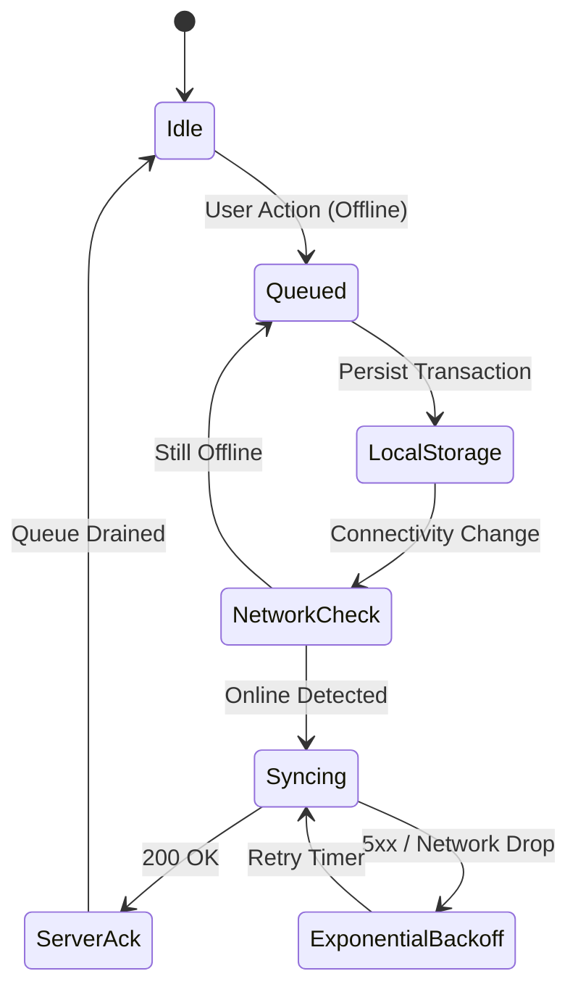

# 🔄 flutter-offline-sync-engine

> **Topics:** `flutter` `offline-first` `sync-engine` `data-synchronization` `queue` `mobile-architecture` `dart`


[](https://github.com/shadialhasan/flutter-offline-sync-engine/releases/tag/v1.0.0)
[](LICENSE)
[](https://flutter.dev)
[](https://github.com/shadialhasan)
[](https://github.com/shadialhasan/flutter-offline-sync-engine/actions)

A robust offline-first synchronization engine for Flutter applications. Guarantees mutation delivery across patchy mobile connectivity by queuing write actions locally and synchronizing seamlessly with enterprise backends upon reconnection.

## 🏗️ Synchronization Lifecycle



---

## ⚙️ Installation & Setup

```bash
git clone https://github.com/shadialhasan/flutter-offline-sync-engine.git
cd flutter-offline-sync-engine
dart pub get
```

## 🚀 Usage

```dart
final engine = OfflineSyncEngine();

// Enqueue write operation while offline
engine.enqueue(SyncOperation(
  id: 'tx_998',
  endpoint: '/api/v1/orders',
  method: 'POST',
  payload: {'order_id': 1234, 'total': 850.0},
));

// Reconnection trigger
engine.setConnectivity(true);
```

---

---

## 🧪 Running Automated Tests

```bash
dart test
```

## 👤 Author & Maintainer

**Eng. MHD. Shadi AL-Hasan**  
- **Role:** Executive CTO & Enterprise Solutions Architect  
- **Email:** [mhd.shadi.alhasan@gmail.com](mailto:mhd.shadi.alhasan@gmail.com)  
- **Phone / WhatsApp:** [+963934005922](tel:+963934005922)  
- **Location:** Damascus, Syria  
- **GitHub:** [shadialhasan](https://github.com/shadialhasan)  

---

## 📄 License

This project is licensed under the MIT License - see the [LICENSE](LICENSE) file for details.  
Copyright (c) 2026 **MHD. Shadi AL-Hasan**. All rights reserved.